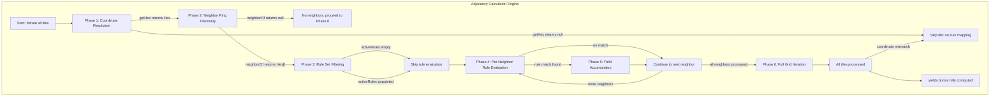

# Technical Requirements

Project: Civ 7 City Planner
Architecture: Single-Page Application (SPA) / Client-Side Only
Language: TypeScript

1. Functional Requirements (FR)

FR-1: Grid Architecture & Geometry

• FR-1.1: The system must maintain a discrete hexagonal grid system utilizing an orientation matching Civilization VII baseline standards.
• FR-1.2: Grid tracking and geometric vectors must use an axial (q, r) or cube (q, r, s) coordinate space to ensure clear neighbor mapping.
• FR-1.3: The initial canvas dimension must default to a fixed rectangular configuration before expansion.

FR-2: State Architecture & Data Schemas

• FR-2.1: Every singular hex cell object in memory must independently carry an explicit data schema containing properties for state validation.
• FR-2.2: The data payload model is in `artefacts/architecture/data-model.md`

FR-3: User Interface & Canvas Interactivity

• FR-3.1: The UI must expose a static Sidebar Tool Picker containing discrete selection brushes for Terrain, Features, Infrastructure, and Meta-states (Starting Tiles).
• FR-3.2: The rendering engine must trap raw cursor pixel coordinates (x, y) on click events over the viewport element.
• FR-3.3: The input system must automatically map screen coordinates to structural grid keys using a bounding box detection matrix.
• FR-3.4: When an active grid key is resolved, the application must write the selected sidebar attribute state into that specific cell index.

FR-4: Adjacency Calculation Engine

• FR-4.1: Any mutation to a tile state must immediately run an evaluation pass across the entire active grid block.
• FR-4.2: The calculation engine must completely flush existing dynamically derived yields before applying rulesets.
• FR-4.3: The calculation engine must query localized neighbor index rings to evaluate specific adjacency criteria. The adjacency evaluation algorithm proceeds through the following ordered phases:

  **Phase 1: Coordinate Resolution**
  Before neighbor traversal can begin, each tile must be mapped to its geometric Hex representation. The engine instantiates a Honeycomb Grid using the map's dimensions (width × height) via the `rectangle()` topology helper. For every tile in the map configuration, the engine calls `grid.getHex({ q: tile.q, r: tile.r })` to retrieve the corresponding Honeycomb Hex object. This step enforces a critical constraint: the axial coordinates (q, r) stored on each tile must exactly match the coordinate space produced by Honeycomb's rectangular grid layout. If `getHex` returns `null` — indicating either a coordinate mismatch or an out-of-bounds position — that tile is excluded from adjacency evaluation for the current pass.

  **Phase 2: Neighbor Ring Discovery**
  For each tile that successfully resolves to a valid Hex, the engine discovers its immediate surrounding ring of adjacent hexagons. Using Honeycomb's `neighborOf(hex, direction)` API with the six pointy-top cardinal directions (E, NE, NW, W, SW, SE), the engine collects all non-null neighbor Hex objects into a flat array. Because the grid has rectangular boundaries, tiles positioned at the edges or corners will have fewer than six neighbors; `null` results from `neighborOf` are filtered out silently. This produces the complete set of adjacent tiles eligible for rule evaluation.

  **Phase 3: Rule Set Filtering**
  The engine filters the global `CIV7_ADJACENCY_RULES` configuration array to isolate only those rules whose `sourceType` field matches the current tile's `infrastructure` value. This produces an `activeRules` array containing every adjacency rule that could potentially apply to this tile based on what infrastructure it hosts. Tiles whose `infrastructure` is `'None'` produce an empty `activeRules` array and are skipped entirely — they contribute no adjacency bonuses and require no further processing.

  **Phase 4: Per-Neighbor Rule Evaluation**
  For each neighbor Hex discovered in Phase 2, the engine resolves the corresponding tile data from the map configuration using the neighbor's (q, r) coordinates as a lookup key. Then, for every rule in `activeRules`, the engine evaluates whether the neighbor satisfies the rule's trigger condition:
  - If `rule.triggerType === 'terrain'`, the neighbor tile's `terrain` property is compared against `rule.triggerTarget`.
  - If `rule.triggerType === 'feature'`, the neighbor tile's `feature` property is compared against `rule.triggerTarget`.
  - If `rule.triggerType === 'infrastructure'`, the neighbor tile's `infrastructure` property is compared against `rule.triggerTarget`.

  A match is recorded when the neighbor's property value strictly equals the rule's `triggerTarget` value. The comparison uses strict equality and is case-sensitive.

  **Phase 5: Yield Accumulation**
  When a rule match is recorded, the engine adds the rule's `bonusYield` values to the source tile's `yields.bonus` accumulator. Each yield field — `food`, `production`, `gold`, `science`, `culture`, `happiness` — is incremented independently by the corresponding value from `bonusYield`. If a field is absent from `bonusYield`, it defaults to 0 and contributes nothing. Multiple rule matches (from different neighbors or different rules) stack additively on the same yield field; for example, a Farm tile adjacent to two other Farm tiles accumulates +2 Food.

  **Phase 6: Full Grid Iteration**
  Phases 1–5 execute iteratively for every tile in the map configuration. The engine guarantees complete coverage: every tile with non-None infrastructure undergoes neighbor-based bonus evaluation, and every eligible neighbor contributes its applicable bonuses. After all tiles have been processed, the `yields.bonus` field on every tile contains the fully computed adjacency-derived yield increments, ready for the final reduction pass defined in FR-4.4.

  

• FR-4.4: The system must run a final reduction step summing yields.base and yields.bonus into yields.total for canvas updates.

2. Non-Functional Requirements (NFR)

NFR-1: Performance & Operational Targets

• NFR-1.1 (Refresh Rate): The canvas clearing and vector draw operations must complete in under 16.67 milliseconds (targeting a native 60 FPS update rate).
• NFR-1.2 (Pipeline Lag): The combined calculation logic sweep and canvas update pipeline must execute in under 50 milliseconds after an edit action, ensuring zero visible interface stutter.
• NFR-1.3 (Memory Load): The total in-memory representation for standard map scales (up to ~7,000 active hex elements) must remain under 50 megabytes of RAM overhead.

NFR-2: Technical Stack & Environment Limits

• NFR-2.1 (Zero Server Overhead): The application must run entirely within the client runtime environment. No remote API dependencies, databases, or active servers are allowed.
• NFR-2.2 (Geometric Dependency): The math engine must rely on Honeycomb to handle coordinate lookups, cursor conversions, and neighbor indexes.
• NFR-2.3 (Rendering Dependency): The visual output pipeline must rely on the native HTML5 Canvas 2D Context API, avoiding complex heavy third-party graphics engines.
• NFR-2.4 (Strict Compilation): The complete code structure must compile under strict TypeScript configurations ("strict": true in tsconfig.json).

NFR-3: Portability & Maintainability

• NFR-3.1 (Compatibility): The application interface and drawing layers must operate natively across modern standard web runtimes supporting ECMAScript 2022+ features.
• NFR-3.2 (Decoupled Engine Logic): The adjacency engine must remain isolated from visual canvas drawing code. Math state shifts must accept and return raw plain object data parameters, making it easy to swap out the frontend view layer later.