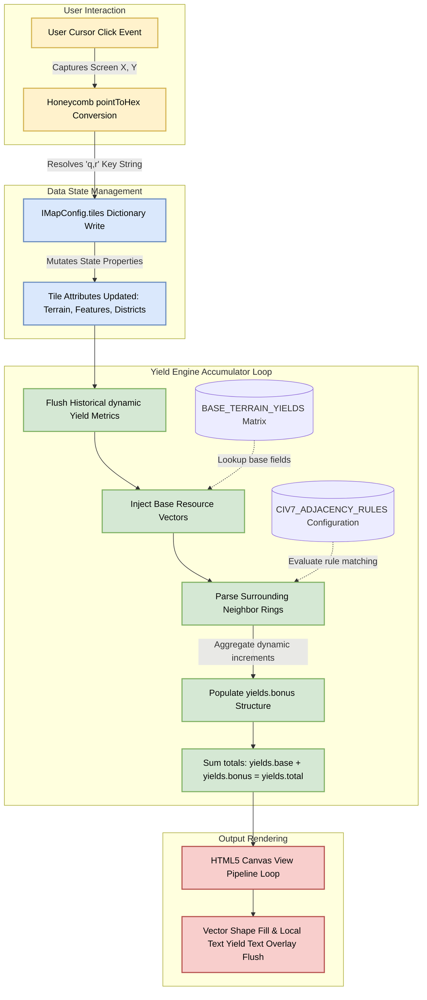

# Civ 7 City Planner: Data Model


---

## Data Objects

Tile:
- Has base value for each Yield
- Is of type Biome
- May contain a Resource to a limit of 1
- May be modified by placing an Improvement to a limit of 1
- May be modified by placing a Building  to a limit of 2
- Gives adjacency bonus depending on: no Improvemement, after Improvement, after Building, after Quarter

Yield:
- Five types of yields: Food, Production, Gold, Science, Culture, Happiness, Influence

Biome:
- Types: Land, Marine
- Land Biome has subtypes: Tundra, Grassland, Plains, Desert, Tropical
- Land Biome subtypes have modifiers: Flat, Rough, Mountainous, Navigable River
- Marine Biome has subtypes: Coastal, Ocean, Lake

Resources:
see `### Bonus Resources – flat yields, any Settlement` in artefacts/product/tiles.md
- modifies one or more base Yields

Improvements:
see `### Types of Improvement` in `artefacts/product/tiles.md in artefacts/product/tiles.md`
- modifies one or more base Yields
- an Improvement on a Natural Wonder is called a Research Station

Settlement:
- Types: City, Town
- Always has a Building at its centre
- Has aggregated value for each Yield
- Settlement border is 3 tiles from centre (excluding centre)

Buildings:
- see `## Buildings` in `artefacts/product/tiles.md in artefacts/product/tiles.md`
- modifies one or more base Yields
- Building at centre of a City Settlement must be of type: Capital
- Building at centre of a Town Settlement must be of type: City Hall
- There are restrictions as to which Building may be placed on which Tile
- Buildings cost maintenance according to type

Quarter:
- Two Buildings placed on the same Tile

Empire:
- One of more Settlements
- May modify Yields across the Empire

Religion:
- May modify Yields across the Empire

### Settlment Yield Calculation

- Each Tile that has an Improvement or one or more Buildings contributes to the Yield
- Each Tile contributes: base value + addition from Improvement or Building + addition from adjacent Tiles
- Each Settlement receives bonus to one of more types of Yield from Empire, Specialists, some Buildings, Religion
- Addition to yield value can be integer (e.g. +1) or percentage (e.g. +10%)

Settlement Yield Algorithm:

1. Retrieve base Yield values from Tile properties
2. Calculate addition to Yield from Tile's Improvements, Buildings, Quarter (as applicable)
3. Calculate addition to Yield from each of the six adjaent Tiles
4. Total Tile Yield
5. Apply Settlement modifier(s)
6. Apply Empire modifier(s)
7. Subract Building maintenance


---

## Implementation Notes

This data model specification defines the complete, strongly typed data layer for your Civilization VII Web Map Planner. It is designed using a normalized, single-directional architecture to cleanly separate static map definitions, active layout configurations, and calculated runtime metrics.

1. Hex Engine Core Schema (TypeScript)

Save this structural blueprint as types.ts inside your development environment:

```typescript
/**
 * Strict layout types representing legitimate terrain and structures matching Civ 7 specifications.
 */
export type TerrainType = 'Ocean' | 'Coast' | 'Grassland' | 'Plains' | 'Desert' | 'Tundra' | 'Mountain';
export type FeatureType = 'None' | 'Woods' | 'Rainforest' | 'Marsh' | 'Oasis' | 'Floodplains';
export type InfrastructureType = 'None' | 'Farm' | 'Mine' | 'Quarry' | 'Campus' | 'Commercial_Hub' | 'Theater_Square' | 'Industrial_Zone';

/**
 * Basic resource bucket structure tracking statistical counters.
 */
export interface IYieldMetrics {
  food: number;
  production: number;
  science: number;
  culture: number;
  gold: number;
}

/**
 * Complete, isolated structural data payload tracking attributes bound to an explicit coordinate map.
 */
export interface ITileState {
  /** Map position tracking keys assigned by the geometry engine */
  q: number;
  r: number;
  
  /** Active terrain, layout, and gameplay property tags */
  terrain: TerrainType;
  feature: FeatureType;
  infrastructure: InfrastructureType;
  isStartingTile: boolean;

  /** Multi-tier asset tracking arrays compiling final runtime yields */
  yields: {
    base: IYieldMetrics;
    bonus: IYieldMetrics;
    total: IYieldMetrics;
  };
}

/**
 * Top-level application store wrapper managing global session configurations.
 */
export interface IMapConfig {
  id: string;
  name: string;
  dimensions: {
    width: number;
    height: number;
  };
  /** Normalized hash map for constant time O(1) attribute lookups using "q,r" strings as index keys */
  tiles: Record<string, ITileState>;
}
```

2. Static Yield Matrix Configuration

To prevent hardcoding base resource attributes directly inside active object generators, use a decoupled lookup dictionary mapping baseline terrain yields:

```typescript
export const BASE_TERRAIN_YIELDS: Record<TerrainType, IYieldMetrics> = {
  Ocean:     { food: 1, production: 0, science: 0, culture: 0, gold: 2 },
  Coast:     { food: 1, production: 0, science: 0, culture: 0, gold: 1 },
  Grassland: { food: 2, production: 0, science: 0, culture: 0, gold: 0 },
  Plains:    { food: 1, production: 1, science: 0, culture: 0, gold: 0 },
  Desert:    { food: 0, production: 0, science: 0, culture: 0, gold: 0 },
  Tundra:    { food: 1, production: 0, science: 0, culture: 0, gold: 0 },
  Mountain:  { food: 0, production: 0, science: 0, culture: 0, gold: 0 }
};

export const BASE_FEATURE_MODIFIERS: Record<FeatureType, Partial<IYieldMetrics>> = {
  None:        {},
  Woods:       { production: 1 },
  Rainforest:  { food: 1 },
  Marsh:       { food: -1, production: 1 },
  Oasis:       { food: 3, gold: 1 },
  Floodplains: { food: 2 }
};
```

3. Structural Adjacency Rule Schema

To allow your mathematical calculation loop to evaluate rule conditions dynamically without hardcoding nested if/else ladders, structure adjacency rulesets as strict configuration records:

```typescript
export interface IAdjacencyRule {
  sourceType: InfrastructureType;
  triggerType: 'terrain' | 'feature' | 'infrastructure';
  triggerTarget: string; // Maps directly to a TerrainType, FeatureType, or InfrastructureType string
  bonusYield: Partial<IYieldMetrics>;
}

export const CIV7_ADJACENCY_RULES: IAdjacencyRule[] = [
  {
    sourceType: 'Campus',
    triggerType: 'terrain',
    triggerTarget: 'Mountain',
    bonusYield: { science: 2 }
  },
  {
    sourceType: 'Industrial_Zone',
    triggerType: 'infrastructure',
    triggerTarget: 'Mine',
    bonusYield: { production: 1 }
  },
  {
    sourceType: 'Farm',
    triggerType: 'infrastructure',
    triggerTarget: 'Farm',
    bonusYield: { food: 1 }
  }
];
```

4. Data Transformation Pipeline & Lifecycle Flow

The diagram below details how data values enter the model, combine with the configuration matrices, and resolve into a flat visual canvas representation:




1. User Action: The user selects a tool brush and clicks a screen target.
2. State Mutation: The application mutates the specific coordinate index key inside IMapConfig.tiles.
3. Calculation Phase: The engine pulls base metrics from BASE_TERRAIN_YIELDS, matches surrounding coordinate arrays against the CIV7_ADJACENCY_RULES array, and sums them.
4. Drawing Execution: The view pipeline handles the data packet seamlessly, updating vector graphics instantly without carrying heavy inline business logic calculations.