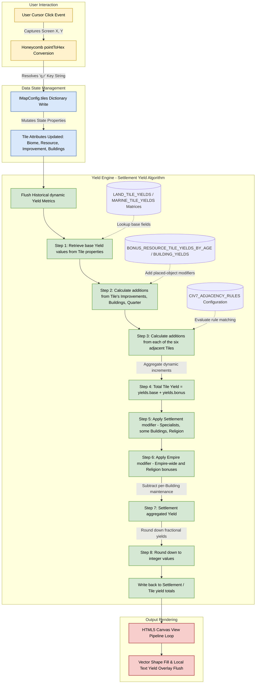

# Civ 7 City Planner: Data Model


---

## Data Objects

Tile:
- Has base value for each Yield
- Is of type Biome
- May contain a Resource to a limit of 1
- May be modified by placing an Improvement to a limit of 1
- May be modified by placing a Building to a limit of 2
- Gives adjacency bonus depending on: no Improvement, after Improvement, after Building, after Quarter

Yield:
- Seven types of yields: Food, Production, Gold, Science, Culture, Happiness, Influence

Biome:
- Types: Land, Marine
- Land Biome has subtypes: Tundra, Grassland, Plains, Desert, Tropical
- Land Biome subtypes have modifiers: Flat, Rough, Mountainous, Navigable River
- Marine Biome has subtypes: Coastal, Ocean, Lake

Resources:
see `## Resources` in `artefacts/product/tiles.md`
- modifies one or more base Yields

Improvements:
see `### Types of Improvement` in `artefacts/product/tiles.md`
- modifies one or more base Yields
- an Improvement on a Natural Wonder is called a Research Station

Settlement:
- Types: City, Town
- Always has a Building at its centre
- Has aggregated value for each Yield
- Settlement border is 3 tiles from centre (excluding centre)

Buildings:
see `## Buildings` in `artefacts/product/tiles.md`
- modifies one or more base Yields
- Building at centre of a City Settlement must be of type: Capital
- Building at centre of a Town Settlement must be of type: City Hall
- There are restrictions as to which Building may be placed on which Tile
- Buildings cost maintenance according to type

Quarter:
- Two Buildings placed on the same Tile

Empire:
- One or more Settlements
- May modify Yields across the Empire

Religion:
- May modify Yields across the Empire

Age:
- Types: Antiquity, Exploration, Modern
- **Assume Antiquity Age only**

### Settlement Yield Calculation

- Each Tile that has an Improvement or one or more Buildings contributes to the Yield
- Each Tile contributes: base value + addition from Improvement or Building + addition from adjacent Tiles
- Each Settlement receives bonuses to one or more types of Yield from Empire, Specialists, some Buildings, and Religion
- Addition to yield value can be integer (e.g. +1) or percentage (e.g. +10%)

Settlement Yield Algorithm:

1. Retrieve base Yield values from Tile properties
2. Calculate addition to Yield from Tile's Improvements, Buildings, Quarter (as applicable)
3. Calculate addition to Yield from each of the six adjacent Tiles
4. Total Tile Yield
5. Apply Settlement modifier(s)
6. Apply Empire modifier(s)
7. Subtract Building maintenance
8. Round down to integer values


---

## Implementation Notes

This data model specification defines the complete, strongly typed data layer for your Civilization VII Web Map Planner. It is designed using a normalized, single-directional architecture that cleanly separates static map definitions (Tiles, Biomes, Resources), active layout state (Improvements, Buildings, Quarters), settlement aggregation (Settlements, Empire, Religion), and calculated runtime yields. It mirrors the Data Objects section above: every entity, field, and limit defined there maps 1:1 onto the structures below, and the Yield Engine implements the Settlement Yield Algorithm exactly as specified.

1. Hex Engine Core Schema (TypeScript)

Save this structural blueprint as types.ts inside your development environment:

```typescript
/**
 * Strict layout types representing legitimate biomes and structures matching Civ 7 specifications.
 */

export type LandModifier = 'Flat' | 'Rough' | 'Mountainous' | 'Navigable_River';

// Marine biome subtypes.
export type MarineSubtype = 'Coastal' | 'Ocean' | 'Lake';

/**
 * The seven Yield types tracked by the engine.
 * Additions can be integer (e.g. +1) or percentage (e.g. +10%) — see IYieldModifier.
 */
export interface IYieldMetrics {
  food: number;
  production: number;
  gold: number;
  science: number;
  culture: number;
  happiness: number;
  influence: number;
}

/**
 * Placeable object enums — canonical lists live in artefacts/product/tiles.md
 * (`## Resources`, `### Types of Improvement`, `## Buildings`).
 */
export type ResourceType =
  | 'Camels' | 'Citrus' | 'Clay' | 'Cloves' | 'Coal' | 'Cocoa' | 'Coffee' | 'Cotton'
  | 'Cowrie' | 'Crabs' | 'Dates' | 'Dyes' | 'Fish' | 'Flax' | 'Furs' | 'Gold' | 'Gypsum'
  | 'Hardwood' | 'Hides' | 'Horses' | 'Incense' | 'Iron' | 'Ivory' | 'Jade' | 'Kaolin'
  | 'Lapis_Lazuli' | 'Limestone' | 'Llamas' | 'Mangoes' | 'Marble' | 'Nickel' | 'Niter'
  | 'Oil' | 'Pearls' | 'Pitch' | 'Quinine' | 'Rice' | 'Rubber' | 'Rubies' | 'Salt'
  | 'Silver' | 'Silk' | 'Spices' | 'Sugar' | 'Tea' | 'Tin' | 'Tobacco' | 'Truffles'
  | 'Turtles' | 'Whales' | 'Wild_Game' | 'Wine' | 'Wool';
export type ImprovementType =
  | 'Farm' | 'Mine' | 'Woodcutter' | 'Clay_Pit' | 'Quarry' | 'Pasture' | 'Camp' | 'Fishing_Boat'
  | 'Research_Station'; // an Improvement on a Natural Wonder
export type BuildingType = 'Capital' | 'City_Hall' | 'Granary' | 'Academy' | 'Market'; // illustrative subset — full list in tiles.md `## Buildings`

/**
 * Terrain Features that carry their own yield-table column
 * (Vegetated / Wet on Land, Aquatic on Marine) — tiles.md `### Terrain Features`.
 */
export type TileFeature = 'Vegetated' | 'Wet' | 'Aquatic';

/** A yield modifier: flat or percentage, scoped to a source. */
export interface IYieldModifier {
  target: keyof IYieldMetrics;
  kind: 'flat' | 'percent';
  value: number;
  source: 'Specialist' | 'Building' | 'Resource' | 'Empire' | 'Religion';
}

/**
 * A single hex tile. Per-object limits are enforced structurally:
 * - resource:     max 1
 * - improvement:  max 1 (an Improvement on a Natural Wonder is a Research Station)
 * - buildings:    max 2 (two Buildings on the same Tile is a Quarter)
 */
export interface ITileState {
  /** Map position tracking keys assigned by the geometry engine */
  q: number;
  r: number;

  /** Biome classification: one Land subtype + modifier, or one Marine subtype. */
  biome: {
    type: BiomeType;
    subtype: LandSubtype | MarineSubtype;
    modifier: LandModifier | null; // Land only
  };

  /** Terrain Feature on the tile (Vegetated / Wet on Land, Aquatic on Marine); selects the yield-table column when present */
  feature: TileFeature | null;

  /** Placed objects, subject to the per-Tile limits above. */
  resource: ResourceType | null;       // limit 1
  improvement: ImprovementType | null; // limit 1
  buildings: BuildingType[];           // limit 2; length === 2 means Quarter

  /** Adjacency stage: no Improvement → after Improvement → after Building → after Quarter */
  adjacencyStage: 'No_Improvement' | 'After_Improvement' | 'After_Building' | 'After_Quarter';

  isStartingTile: boolean;

  /** Multi-tier asset tracking arrays compiling final runtime yields */
  yields: {
    base: IYieldMetrics;
    bonus: IYieldMetrics;
    total: IYieldMetrics;
  };
}

/**
 * A Settlement (City or Town). Border radius is 3 tiles from the centre, excluding the centre.
 */
export interface ISettlementState {
  type: 'City' | 'Town';
  /** Centre tile — always holds a Building: Capital for City, City Hall for Town. */
  centre: { q: number; r: number };
  borderRadius: 3;               // tiles from centre, excluding centre
  tileKeys: string[];            // "q,r" keys of tiles inside the border
  yields: IYieldMetrics;         // aggregated value for each Yield
  modifiers: IYieldModifier[];   // from Specialists, some Buildings, Religion
}

/** The Empire: one or more Settlements plus empire-wide Yield modifiers. */
export interface IEmpireState {
  settlements: ISettlementState[]; // one or more
  modifiers: IYieldModifier[];     // Empire and Religion may modify Yields across the Empire
}

/**
 * Top-level application store wrapper managing global session configurations.
 */
export interface IMapConfig {
  id: string;
  name: string;
  dimensions: {
    width: number;
    height: number;
  };
  /** Normalized hash map for constant time O(1) attribute lookups using "q,r" strings as index keys */
  tiles: Record<string, ITileState>;
  empire: IEmpireState;
}
```

2. Static Yield Matrix Configuration

Base Yields come directly from the Tile Yields tables in `artefacts/product/tiles.md`. A Land Tile's base is a joint lookup of Biome subtype and surface class — the table columns are the four Biome modifiers (Flat, Rough, Mountainous, Navigable River) plus the Vegetated and Wet Terrain Features — so the (subtype, surface) pair selects one cell. Marine Tiles key on subtype and feature state. The published values do not decompose into a base plus uniform modifier deltas, so the matrices below are keyed by the full pair instead of base + adjustment. Placeable objects (Resources, Buildings) apply their own modifiers over that base:

```typescript
/**
 * Land tile yields — canonical values from tiles.md `### Land`.
 * Omitted yields are 0. Footnotes from tiles.md:
 * - Flat: +1 Food from Floodplains
 * - Wet: -1 Production in the Antiquity Age until Pottery is researched
 * - Mountainous: no base yields when the tile is a Volcano
 */
export type LandSurface = 'Flat' | 'Rough' | 'Vegetated' | 'Wet' | 'Mountainous' | 'Navigable_River';

export const LAND_TILE_YIELDS: Record<LandSubtype, Record<LandSurface, Partial<IYieldMetrics>>> = {
  Tundra: {
    Flat:            { production: 1, culture: 1 },
    Rough:           { production: 2 },
    Vegetated:       { food: 1, production: 1, culture: 1 },
    Wet:             { food: 1, production: 1, culture: 1 },
    Mountainous:     { production: 1 },
    Navigable_River: { food: 1, gold: 1 }
  },
  Grassland: {
    Flat:            { food: 2 },
    Rough:           { food: 1, production: 1 },
    Vegetated:       { food: 2, production: 1 },
    Wet:             { food: 2, production: 1 },
    Mountainous:     { food: 1 },
    Navigable_River: { food: 1, gold: 1 }
  },
  Plains: {
    Flat:            { food: 1, production: 1 },
    Rough:           { production: 2 },
    Vegetated:       { food: 1, production: 2 },
    Wet:             { food: 1, production: 2 },
    Mountainous:     { production: 1 },
    Navigable_River: { food: 1, gold: 1 }
  },
  Desert: {
    Flat:            { production: 1, gold: 1 },
    Rough:           { production: 2 },
    Vegetated:       { food: 1, production: 1, gold: 1 },
    Wet:             { food: 1, production: 2 },
    Mountainous:     { gold: 1 },
    Navigable_River: { food: 1, gold: 1 }
  },
  Tropical: {
    Flat:            { food: 1, science: 1 },
    Rough:           { food: 1, production: 1 },
    Vegetated:       { food: 1, production: 1, science: 1 },
    Wet:             { food: 1, production: 1, science: 1 },
    Mountainous:     { production: 1 },
    Navigable_River: { food: 1, gold: 1 }
  }
};

/**
 * Marine tile yields — canonical values from tiles.md `### Marine`.
 * Footnotes from tiles.md:
 * - Ocean Featureless yields apply from the Modern Age only
 * - Ocean Aquatic yields are not available in the Antiquity Age
 */
export type MarineSurface = 'Featureless' | 'Aquatic';

export const MARINE_TILE_YIELDS: Record<MarineSubtype, Record<MarineSurface, Partial<IYieldMetrics>>> = {
  Lake:    { Featureless: { food: 1, gold: 1 }, Aquatic: { food: 2, culture: 1 } },
  Coastal: { Featureless: { food: 1, gold: 1 }, Aquatic: { food: 1, production: 1, science: 1 } },
  Ocean:   { Featureless: { food: 1, gold: 1 }, Aquatic: { food: 2, production: 2, culture: 1 } }
};

/**
 * Resources are grouped by Kind, which maps each resource onto the
 * Settlement Yield Algorithm: Bonus -> tile additions (step 2); City ->
 * Settlement modifier once slotted (step 5); Empire -> Empire modifier
 * (step 6); Treasure -> settlement modifier (step 5, Exploration Age);
 * Factory -> settlement modifier requiring a Factory (step 5, Modern Age).
 * Canonical values: tiles.md `## Resources`.
 */

export type ResourceKind = 'Bonus' | 'City' | 'Empire' | 'Treasure' | 'Factory';

/** Per-Age resource kinds — canonical values in tiles.md `## Resources`. */
export type GameAge = 'Antiquity' | 'Exploration' | 'Modern';

export const RESOURCE_KINDS_BY_AGE: Record<GameAge, Partial<Record<ResourceType, ResourceKind>>> = {
  Antiquity: {
    // Bonus
    Clay: 'Bonus', Cotton: 'Bonus', Cowrie: 'Bonus', Crabs: 'Bonus', Dates: 'Bonus',
    Dyes: 'Bonus', Fish: 'Bonus', Hides: 'Bonus', Llamas: 'Bonus', Rubies: 'Bonus',
    Tin: 'Bonus', Turtles: 'Bonus', Wild_Game: 'Bonus', Wool: 'Bonus',
    // City
    Camels: 'City', Flax: 'City', Gypsum: 'City', Incense: 'City', Jade: 'City',
    Kaolin: 'City', Lapis_Lazuli: 'City', Mangoes: 'City', Pearls: 'City', Salt: 'City',
    Silk: 'City',
    // Empire
    Gold: 'Empire', Hardwood: 'Empire', Horses: 'Empire', Iron: 'Empire', Ivory: 'Empire',
    Limestone: 'Empire', Marble: 'Empire', Rice: 'Empire', Silver: 'Empire', Wine: 'Empire'
  },
  Exploration: {
    // Bonus
    Clay: 'Bonus', Cotton: 'Bonus', Cowrie: 'Bonus', Crabs: 'Bonus', Dates: 'Bonus',
    Dyes: 'Bonus', Fish: 'Bonus', Flax: 'Bonus', Ivory: 'Bonus', Llamas: 'Bonus',
    Pitch: 'Bonus', Tin: 'Bonus', Turtles: 'Bonus', Whales: 'Bonus', Wild_Game: 'Bonus',
    // City
    Camels: 'City', Cloves: 'City', Gypsum: 'City', Incense: 'City', Jade: 'City',
    Kaolin: 'City', Mangoes: 'City', Pearls: 'City', Silk: 'City', Truffles: 'City',
    // Empire
    Hardwood: 'Empire', Iron: 'Empire', Limestone: 'Empire', Marble: 'Empire', Niter: 'Empire',
    Rice: 'Empire', Wine: 'Empire',
    // Treasure
    Cocoa: 'Treasure', Furs: 'Treasure', Gold: 'Treasure', Horses: 'Treasure', Rubies: 'Treasure',
    Silver: 'Treasure', Spices: 'Treasure', Sugar: 'Treasure', Tea: 'Treasure'
  },
  Modern: {
    // Bonus
    Cowrie: 'Bonus', Crabs: 'Bonus', Fish: 'Bonus', Horses: 'Bonus', Ivory: 'Bonus',
    Llamas: 'Bonus', Pitch: 'Bonus', Spices: 'Bonus', Sugar: 'Bonus', Whales: 'Bonus',
    Wine: 'Bonus',
    // City
    Furs: 'City', Nickel: 'City', Pearls: 'City', Silk: 'City', Tobacco: 'City',
    Truffles: 'City',
    // Empire
    Coal: 'Empire', Gold: 'Empire', Hardwood: 'Empire', Limestone: 'Empire', Marble: 'Empire',
    Niter: 'Empire', Oil: 'Empire', Rice: 'Empire', Rubber: 'Empire', Silver: 'Empire',
    // Factory
    Citrus: 'Factory', Cocoa: 'Factory', Coffee: 'Factory', Cotton: 'Factory', Kaolin: 'Factory',
    Quinine: 'Factory', Tea: 'Factory', Tin: 'Factory'
  }
};

/**
 * Flat yields a Bonus resource adds to its own Tile, per Age.
 * Scoped Bonus resources apply elsewhere and are NOT tile-level
 * (Warehouse Building effects, settlement-scoped City/Town amounts).
 */
export const BONUS_RESOURCE_TILE_YIELDS_BY_AGE: Record<GameAge, Partial<Record<ResourceType, Partial<IYieldMetrics>>>> = {
  Antiquity: {
    Cotton: { food: 2, production: 2 },
    Dates: { food: 2, happiness: 2 },
    Dyes: { happiness: 4 },
    Fish: { food: 3 },
    Hides: { production: 3 },
    Llamas: { happiness: 3, production: 1 },
    Rubies: { gold: 4 },
    Wool: { happiness: 2, production: 2 }
  },
  Exploration: {
    Cotton: { food: 3, production: 3 },
    Dates: { food: 3, happiness: 3 },
    Dyes: { happiness: 5 },
    Fish: { food: 5 },
    Flax: { culture: 2, science: 2 },
    Ivory: { happiness: 3, production: 3 },
    Llamas: { happiness: 5, production: 1 },
    Tin: { gold: 3, production: 3 },
    Whales: { production: 5 }
  },
  Modern: {
    Horses: { happiness: 8 },
    Ivory: { happiness: 4, production: 4 },
    Llamas: { happiness: 7, production: 1 },
    Spices: { food: 4, happiness: 4 },
    Sugar: { food: 8 },
    Whales: { production: 8 },
    Wine: { food: 4, production: 4 }
  }
};

/**
 * Non-yield effects (Resource capacity, Unit combat bonuses) live outside the
 * yield model; percentage and scaling effects apply as IYieldModifier
 * instances (source: 'Resource').
 */
```

3. Structural Adjacency Rule Schema

A Tile gives an adjacency bonus depending on its stage — no Improvement, after Improvement, after Building, after Quarter — and receives adjacency from the six Tiles around it. To allow the mathematical calculation loop to evaluate rule conditions dynamically without hardcoding nested if/else ladders, structure adjacency rulesets as strict configuration records:

```typescript
/**
 * Adjacency bonus received by a placed object.
 * sourceType is the Improvement/Building/Quarter receiving the bonus;
 * triggerTarget mirrors the neighbor's value under triggerType.
 */
export interface IAdjacencyRule {
  source: 'Improvement' | 'Building' | 'Quarter';
  sourceTarget: string; // ImprovementType / BuildingType value
  sourceStage: 'No_Improvement' | 'After_Improvement' | 'After_Building' | 'After_Quarter';
  triggerType: 'biome' | 'biome_modifier' | 'resource' | 'improvement' | 'building' | 'quarter';
  triggerTarget: string; // Maps to a Biome subtype, LandModifier, Resource, Improvement, or Building string
  bonusYield: Partial<IYieldMetrics>;
}

export const CIV7_ADJACENCY_RULES: IAdjacencyRule[] = [
  {
    source: 'Building',
    sourceTarget: 'Academy',
    sourceStage: 'After_Building',
    triggerType: 'biome_modifier',
    triggerTarget: 'Mountainous',
    bonusYield: { science: 2 }
  },
  {
    source: 'Building',
    sourceTarget: 'Granary',
    sourceStage: 'After_Building',
    triggerType: 'biome',
    triggerTarget: 'Grassland',
    bonusYield: { food: 1 }
  },
  {
    source: 'Improvement',
    sourceTarget: 'Farm',
    sourceStage: 'After_Improvement',
    triggerType: 'improvement',
    triggerTarget: 'Farm',
    bonusYield: { food: 1 }
  }
];
```

4. Data Transformation Pipeline & Lifecycle Flow — Settlement Yield Algorithm

The diagram below details how data values enter the model, combine with the configuration matrices, and resolve into a flat visual canvas representation. It maps 1:1 onto the Settlement Yield Algorithm from the Data Objects section:




1. User Action: The user selects a tool brush and clicks a screen target.
2. State Mutation: The application mutates the specific coordinate index key inside IMapConfig.tiles — updating its Biome, Resource, Improvement, or Buildings subject to the per-Tile limits.
3. Calculation Phase — Tile (steps 1–4): The engine looks up base metrics in LAND_TILE_YIELDS / MARINE_TILE_YIELDS by Biome subtype and surface (modifier or Terrain Feature), applies the BONUS_RESOURCE_TILE_YIELDS_BY_AGE and BUILDING_YIELDS matrices for the active Age, matches surrounding coordinate arrays against CIV7_ADJACENCY_RULES, and sums yields.base + yields.bonus into yields.total.
4. Aggregation Phase — Settlement (steps 5–8): Working tiles inside the 3-tile border (excluding centre) aggregate into ISettlementState.yields; Settlement modifiers (Specialists, some Buildings, Religion) and then Empire modifiers are applied; per-Building maintenance is subtracted. Additions may be integer or percentage; fractional results are rounded down to integer values.
5. Drawing Execution: The view pipeline handles the data packet seamlessly, updating vector graphics instantly without carrying heavy inline business logic calculations.
